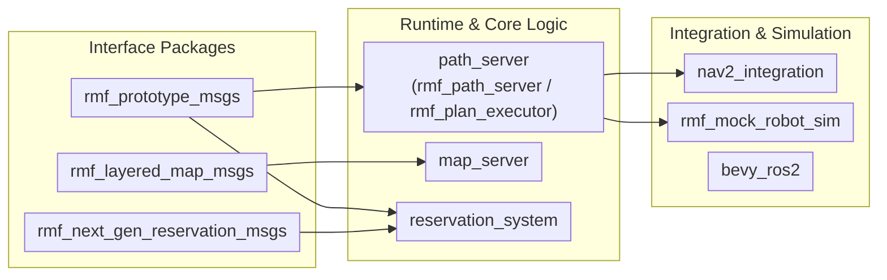
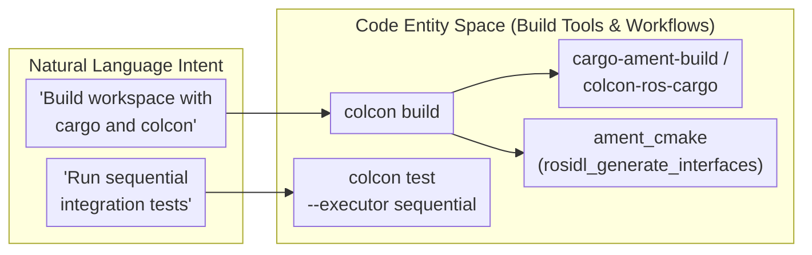
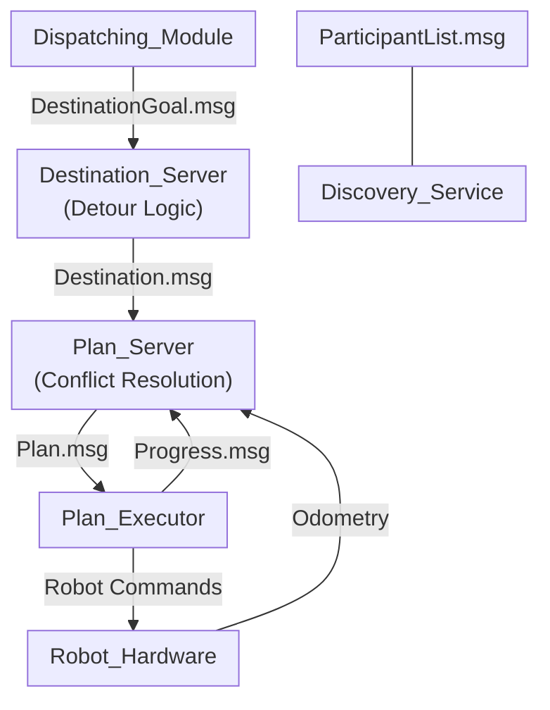
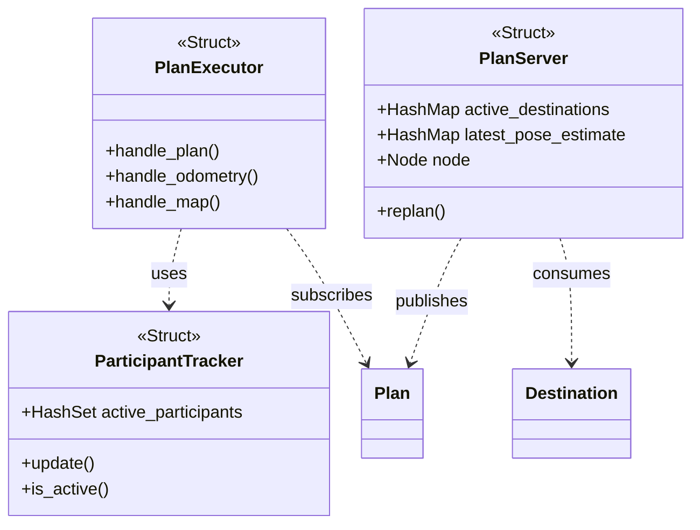

# Architecture

This page covers the repository and build structure of `next_gen_prototype` as well as the high-level architecture of the next-generation Open-RMF traffic management system.

<details>
<summary>Relevant source files</summary>

The following files were used as context for generating this page:

- [`README.md:1-100`](https://github.com/open-rmf/next_gen_prototype/blob/9403fb16177d8b0b5a58bad7c8c7690226675122/README.md#L1-L100)
- [`bevy_ros2/Cargo.toml:1-12`](https://github.com/open-rmf/next_gen_prototype/blob/9403fb16177d8b0b5a58bad7c8c7690226675122/bevy_ros2/Cargo.toml#L1-L12)
- [`discourse/2-traffic-management-interfaces.md:1-32`](https://github.com/open-rmf/next_gen_prototype/blob/9403fb16177d8b0b5a58bad7c8c7690226675122/discourse/2-traffic-management-interfaces.md#L1-L32)
- [`map_server/README.md:1-15`](https://github.com/open-rmf/next_gen_prototype/blob/9403fb16177d8b0b5a58bad7c8c7690226675122/map_server/README.md#L1-L15)
- [`nav2_integration/README.md:1-5`](https://github.com/open-rmf/next_gen_prototype/blob/9403fb16177d8b0b5a58bad7c8c7690226675122/nav2_integration/README.md#L1-L5)
- [`path_server/rmf_path_server/Cargo.toml:1-16`](https://github.com/open-rmf/next_gen_prototype/blob/9403fb16177d8b0b5a58bad7c8c7690226675122/path_server/rmf_path_server/Cargo.toml#L1-L16)
- [`path_server/rmf_path_server/src/lib.rs:1-671`](https://github.com/open-rmf/next_gen_prototype/blob/9403fb16177d8b0b5a58bad7c8c7690226675122/path_server/rmf_path_server/src/lib.rs#L1-L671)
- [`path_server/rmf_plan_executor/Cargo.toml:1-12`](https://github.com/open-rmf/next_gen_prototype/blob/9403fb16177d8b0b5a58bad7c8c7690226675122/path_server/rmf_plan_executor/Cargo.toml#L1-L12)
- [`path_server/rmf_plan_executor/src/main.rs:1-159`](https://github.com/open-rmf/next_gen_prototype/blob/9403fb16177d8b0b5a58bad7c8c7690226675122/path_server/rmf_plan_executor/src/main.rs#L1-L159)
- [`reservation_system/README.md:1-47`](https://github.com/open-rmf/next_gen_prototype/blob/9403fb16177d8b0b5a58bad7c8c7690226675122/reservation_system/README.md#L1-L47)
- [`rmf_layered_map_msgs/CMakeLists.txt:1-37`](https://github.com/open-rmf/next_gen_prototype/blob/9403fb16177d8b0b5a58bad7c8c7690226675122/rmf_layered_map_msgs/CMakeLists.txt#L1-L37)
- [`rmf_mock_robot_sim/README.md:1-3`](https://github.com/open-rmf/next_gen_prototype/blob/9403fb16177d8b0b5a58bad7c8c7690226675122/rmf_mock_robot_sim/README.md#L1-L3)
- [`rmf_next_gen_reservation_msgs/CMakeLists.txt:1-31`](https://github.com/open-rmf/next_gen_prototype/blob/9403fb16177d8b0b5a58bad7c8c7690226675122/rmf_next_gen_reservation_msgs/CMakeLists.txt#L1-L31)
- [`rmf_participant_discovery/Cargo.toml:1-8`](https://github.com/open-rmf/next_gen_prototype/blob/9403fb16177d8b0b5a58bad7c8c7690226675122/rmf_participant_discovery/Cargo.toml#L1-L8)
- [`rmf_participant_discovery/src/lib.rs:1-157`](https://github.com/open-rmf/next_gen_prototype/blob/9403fb16177d8b0b5a58bad7c8c7690226675122/rmf_participant_discovery/src/lib.rs#L1-L157)
- [`rmf_prototype_msgs/CMakeLists.txt:1-57`](https://github.com/open-rmf/next_gen_prototype/blob/9403fb16177d8b0b5a58bad7c8c7690226675122/rmf_prototype_msgs/CMakeLists.txt#L1-L57)
- [`rmf_prototype_msgs/msg/GraphElementKey.msg:1-53`](https://github.com/open-rmf/next_gen_prototype/blob/9403fb16177d8b0b5a58bad7c8c7690226675122/rmf_prototype_msgs/msg/GraphElementKey.msg#L1-L53)
- [`rmf_prototype_msgs/msg/TargetNode.msg:1-13`](https://github.com/open-rmf/next_gen_prototype/blob/9403fb16177d8b0b5a58bad7c8c7690226675122/rmf_prototype_msgs/msg/TargetNode.msg#L1-L13)
- [`rmf_prototype_msgs/msg/Trajectory.msg:1-38`](https://github.com/open-rmf/next_gen_prototype/blob/9403fb16177d8b0b5a58bad7c8c7690226675122/rmf_prototype_msgs/msg/Trajectory.msg#L1-L38)

</details>

---

## Repository Structure and Package Layout

This section details the organizational structure of the `next_gen_prototype` repository, covering its package layout—including interface definitions, Rust-based runtime nodes, map servers, and simulation packages—along with the hybrid build system utilizing `colcon`, `ament_cmake`, and `cargo-ament-build`.

### Repository Layout and Package Categorization

The repository is organized as a polyglot ROS 2 workspace containing C++, Python, and Rust packages. The packages are categorized by their functional domain into message definitions, runtime servers, integration layers, and documentation.

#### 1. Interface and Message Packages
* **`rmf_prototype_msgs`**: Defines core navigation, geometry, destination, plan, and participant discovery ROS 2 messages used across the traffic management architecture [`rmf_prototype_msgs/CMakeLists.txt:21-53`](https://github.com/open-rmf/next_gen_prototype/blob/9403fb16177d8b0b5a58bad7c8c7690226675122/rmf_prototype_msgs/CMakeLists.txt#L21-L53).
* **`rmf_layered_map_msgs`**: Contains specialized messages for layered map updates, observation sources, and spatial patch contributions [`rmf_layered_map_msgs/CMakeLists.txt:21-27`](https://github.com/open-rmf/next_gen_prototype/blob/9403fb16177d8b0b5a58bad7c8c7690226675122/rmf_layered_map_msgs/CMakeLists.txt#L21-L27).
* **`rmf_next_gen_reservation_msgs`**: Provides message definitions for destination reservation configurations, named regions, and queueing states [`rmf_next_gen_reservation_msgs/CMakeLists.txt:18-21`](https://github.com/open-rmf/next_gen_prototype/blob/9403fb16177d8b0b5a58bad7c8c7690226675122/rmf_next_gen_reservation_msgs/CMakeLists.txt#L18-L21).

#### 2. Runtime Servers and Logic Packages
* **`path_server`**: Houses Rust-based core services, notably `rmf_path_server` (implementing destination ingestion and MAPF planning) [`path_server/rmf_path_server/Cargo.toml:1-16`](https://github.com/open-rmf/next_gen_prototype/blob/9403fb16177d8b0b5a58bad7c8c7690226675122/path_server/rmf_path_server/Cargo.toml#L1-L16) and `rmf_plan_executor` (managing per-robot execution and waypoint followers) [`path_server/rmf_plan_executor/Cargo.toml:1-12`](https://github.com/open-rmf/next_gen_prototype/blob/9403fb16177d8b0b5a58bad7c8c7690226675122/path_server/rmf_plan_executor/Cargo.toml#L1-L12).
* **`map_server`**: Implements layered occupancy grid composition, TTL-bounded regional patches, and source contribution tracking [`map_server/README.md:1-15`](https://github.com/open-rmf/next_gen_prototype/blob/9403fb16177d8b0b5a58bad7c8c7690226675122/map_server/README.md#L1-L15).
* **`reservation_system`**: Manages occupancy tracking, safe sets, queueing logic, and parking detours for destination servers [`reservation_system/README.md:1-27`](https://github.com/open-rmf/next_gen_prototype/blob/9403fb16177d8b0b5a58bad7c8c7690226675122/reservation_system/README.md#L1-L27).

#### 3. Integration, Simulation, and Tooling Packages
* **`nav2_integration`**: Bridges Open-RMF traffic management with Nav2 action servers and costmap layers (`sp_demo_nav2_bringup`) [`nav2_integration/README.md:1-5`](https://github.com/open-rmf/next_gen_prototype/blob/9403fb16177d8b0b5a58bad7c8c7690226675122/nav2_integration/README.md#L1-L5).
* **`rmf_mock_robot_sim`**: Provides mock robot simulation nodes that register via `rmf_participant_discovery` and follow generated plan waypoints [`rmf_mock_robot_sim/README.md:1-3`](https://github.com/open-rmf/next_gen_prototype/blob/9403fb16177d8b0b5a58bad7c8c7690226675122/rmf_mock_robot_sim/README.md#L1-L3).
* **`bevy_ros2`**: An experimental Rust crate bridging Bevy ECS with ROS 2 execution using `rclrs` [`bevy_ros2/Cargo.toml:1-12`](https://github.com/open-rmf/next_gen_prototype/blob/9403fb16177d8b0b5a58bad7c8c7690226675122/bevy_ros2/Cargo.toml#L1-L12).
* **`discourse`**: Contains design documentation, architecture proposals, and SVG diagrams for the next-generation redesign [`discourse/2-traffic-management-interfaces.md:1-32`](https://github.com/open-rmf/next_gen_prototype/blob/9403fb16177d8b0b5a58bad7c8c7690226675122/discourse/2-traffic-management-interfaces.md#L1-L32).

**Diagram: Repository Package Layout and Dependencies**



Sources: [`README.md:1-11`](https://github.com/open-rmf/next_gen_prototype/blob/9403fb16177d8b0b5a58bad7c8c7690226675122/README.md#L1-L11), [`path_server/rmf_path_server/Cargo.toml:1-16`](https://github.com/open-rmf/next_gen_prototype/blob/9403fb16177d8b0b5a58bad7c8c7690226675122/path_server/rmf_path_server/Cargo.toml#L1-L16), [`path_server/rmf_plan_executor/Cargo.toml:1-12`](https://github.com/open-rmf/next_gen_prototype/blob/9403fb16177d8b0b5a58bad7c8c7690226675122/path_server/rmf_plan_executor/Cargo.toml#L1-L12)

### Build System Architecture

The workspace relies on a hybrid build infrastructure combining standard ROS 2 `colcon` orchestration with `ament_cmake` for C++ packages and `cargo-ament-build` / `colcon-ros-cargo` for Rust crates [`README.md:15-48`](https://github.com/open-rmf/next_gen_prototype/blob/9403fb16177d8b0b5a58bad7c8c7690226675122/README.md#L15-L48).

#### Build Toolchain and Extensions
* **`colcon`**: The primary workspace orchestration tool used to discover, order, and build packages across languages [`README.md:75-80`](https://github.com/open-rmf/next_gen_prototype/blob/9403fb16177d8b0b5a58bad7c8c7690226675122/README.md#L75-L80).
* **`ament_cmake`**: Used by message packages and C++ demonstration nodes to integrate with the ROS 2 build system and generate interface libraries (`rosidl`) [`rmf_prototype_msgs/CMakeLists.txt:15-20`](https://github.com/open-rmf/next_gen_prototype/blob/9403fb16177d8b0b5a58bad7c8c7690226675122/rmf_prototype_msgs/CMakeLists.txt#L15-L20).
* **`cargo-ament-build` / `colcon-ros-cargo`**: Bridges Cargo packages into the `colcon` build lifecycle, ensuring Rust crates like `rmf_path_server` and `rmf_plan_executor` correctly link against ROS 2 shared libraries and message headers [`README.md:38-47`](https://github.com/open-rmf/next_gen_prototype/blob/9403fb16177d8b0b5a58bad7c8c7690226675122/README.md#L38-L47).

**Diagram: Build Toolchain Bridge (Natural Language to Code Entities)**



Sources: [`README.md:25-86`](https://github.com/open-rmf/next_gen_prototype/blob/9403fb16177d8b0b5a58bad7c8c7690226675122/README.md#L25-L86), [`path_server/rmf_path_server/Cargo.toml:1-16`](https://github.com/open-rmf/next_gen_prototype/blob/9403fb16177d8b0b5a58bad7c8c7690226675122/path_server/rmf_path_server/Cargo.toml#L1-L16)

---

## Traffic Management Architecture

### Purpose and Scope

The next-generation Open-RMF traffic management architecture is designed as a modular, four-layered system that separates intent, reservation, planning, and execution [`path_server/rmf_path_server/src/lib.rs:1-671`](https://github.com/open-rmf/next_gen_prototype/blob/9403fb16177d8b0b5a58bad7c8c7690226675122/path_server/rmf_path_server/src/lib.rs#L1-L671). By utilizing a two-topic interface topology (`~/destination` and `~/plan`), the system achieves interoperability between heterogeneous robot types (AGVs and AMRs) and industry standards such as VDA5050 and MassRobotics AMR Interop.

As a parent overview, this section describes the architecture, its functional modules, and the core data flow. For deep technical details on specific subsystems, refer to the child pages:
- **Destination Interface (`~/destination`)**: [Destination Interface (`~/destination`)](https://deepwiki.com/open-rmf/next_gen_prototype/2.1-destination-interface-(~destination))
- **Plan Interface (`~/plan`)**: {doc}`architecture/plan_interface`
- **Waypoint Lifecycle and Traffic Dependencies**: {doc}`architecture/waypoint_lifecycle`

### Interface Topology

The architecture revolves around two base topic families. Each robot or participant in the system prefixes these topics with its unique namespace [`path_server/rmf_plan_executor/src/main.rs:97-98`](https://github.com/open-rmf/next_gen_prototype/blob/9403fb16177d8b0b5a58bad7c8c7690226675122/path_server/rmf_plan_executor/src/main.rs#L97-L98).

#### 1. Destination Interface (`~/destination`)
The Destination interface represents the **Intent Layer**, communicating where a robot needs to go [`path_server/rmf_path_server/src/lib.rs:90-120`](https://github.com/open-rmf/next_gen_prototype/blob/9403fb16177d8b0b5a58bad7c8c7690226675122/path_server/rmf_path_server/src/lib.rs#L90-L120).
* **Purpose**: Resolves where a robot should be and handles goal conflicts via a Destination Server.
* **Key Messages**: `Destination`, `DestinationGoal`, `DestinationError`, and `ParticipantList` for discovery [`rmf_prototype_msgs/CMakeLists.txt:24-31`](https://github.com/open-rmf/next_gen_prototype/blob/9403fb16177d8b0b5a58bad7c8c7690226675122/rmf_prototype_msgs/CMakeLists.txt#L24-L31).
* **For details, see [Destination Interface (`~/destination`)](https://deepwiki.com/open-rmf/next_gen_prototype/2.1-destination-interface-(~destination))**.

#### 2. Plan Interface (`~/plan`)
The Plan interface represents the **Execution Layer**, communicating the specific, conflict-free multi-agent trajectory that a robot must follow [`path_server/rmf_plan_executor/src/main.rs:118-124`](https://github.com/open-rmf/next_gen_prototype/blob/9403fb16177d8b0b5a58bad7c8c7690226675122/path_server/rmf_plan_executor/src/main.rs#L118-L124).
* **Purpose**: Provides a synchronized schedule of waypoints, including traffic dependencies.
* **Key Messages**: `Plan`, `Progress`, `PlanRelease`, and `PlanError` [`rmf_prototype_msgs/CMakeLists.txt:32-36`](https://github.com/open-rmf/next_gen_prototype/blob/9403fb16177d8b0b5a58bad7c8c7690226675122/rmf_prototype_msgs/CMakeLists.txt#L32-L36).
* **For details, see {doc}`architecture/plan_interface`**.

Sources: [`rmf_prototype_msgs/CMakeLists.txt:21-53`](https://github.com/open-rmf/next_gen_prototype/blob/9403fb16177d8b0b5a58bad7c8c7690226675122/rmf_prototype_msgs/CMakeLists.txt#L21-L53), [`path_server/rmf_path_server/src/lib.rs:90-120`](https://github.com/open-rmf/next_gen_prototype/blob/9403fb16177d8b0b5a58bad7c8c7690226675122/path_server/rmf_path_server/src/lib.rs#L90-L120)

### Functional Modules and Data Flow

The architecture is divided into four functional modules that can be implemented independently or replaced by vendor-specific solutions [`path_server/rmf_path_server/src/lib.rs:46-62`](https://github.com/open-rmf/next_gen_prototype/blob/9403fb16177d8b0b5a58bad7c8c7690226675122/path_server/rmf_path_server/src/lib.rs#L46-L62).

#### System Data Flow Diagram
The following diagram illustrates how data flows from high-level goals down to low-level robot execution, bridging conceptual modules to codebase entities.



Sources: [`path_server/rmf_path_server/src/lib.rs:46-132`](https://github.com/open-rmf/next_gen_prototype/blob/9403fb16177d8b0b5a58bad7c8c7690226675122/path_server/rmf_path_server/src/lib.rs#L46-L132), [`path_server/rmf_plan_executor/src/main.rs:56-74`](https://github.com/open-rmf/next_gen_prototype/blob/9403fb16177d8b0b5a58bad7c8c7690226675122/path_server/rmf_plan_executor/src/main.rs#L56-L74)

### Module Definitions

#### Dispatching Module
Responsible for assigning tasks and goals to robots. It interacts primarily with the `~/destination/goal` component.

#### Destination Server (Reservation)
Identifies conflicts between multiple robots' goals. If two robots target the same destination, the server can issue a detour destination (e.g., a parking spot) to one robot while the other proceeds [`path_server/rmf_path_server/src/lib.rs:90-120`](https://github.com/open-rmf/next_gen_prototype/blob/9403fb16177d8b0b5a58bad7c8c7690226675122/path_server/rmf_path_server/src/lib.rs#L90-L120).
* **Input**: `DestinationGoal`
* **Output**: `Destination` [`path_server/rmf_path_server/src/lib.rs:90-120`](https://github.com/open-rmf/next_gen_prototype/blob/9403fb16177d8b0b5a58bad7c8c7690226675122/path_server/rmf_path_server/src/lib.rs#L90-L120)

#### Plan Server (Planning)
Generates conflict-free trajectories (`rmf_path_server`) [`path_server/rmf_path_server/src/lib.rs:46-62`](https://github.com/open-rmf/next_gen_prototype/blob/9403fb16177d8b0b5a58bad7c8c7690226675122/path_server/rmf_path_server/src/lib.rs#L46-L62). It consumes the `Destination` and current `Odometry` to produce a `Plan` consisting of multiple `Waypoints`. It manages spatial-temporal dependencies between different participants.
* **Output**: `Plan` [`path_server/rmf_path_server/src/lib.rs:52`](https://github.com/open-rmf/next_gen_prototype/blob/9403fb16177d8b0b5a58bad7c8c7690226675122/path_server/rmf_path_server/src/lib.rs#L52)

#### Plan Executor (Execution)
The local component on the robot or proxy node (`rmf_plan_executor`) that processes the `Plan` [`path_server/rmf_plan_executor/src/main.rs:45-55`](https://github.com/open-rmf/next_gen_prototype/blob/9403fb16177d8b0b5a58bad7c8c7690226675122/path_server/rmf_plan_executor/src/main.rs#L45-L55). It handles the lifecycle of each waypoint, including arrival actions, departure blockers, and departure trajectories.
* **Feedback**: `Progress`
* **For details, see {doc}`architecture/waypoint_lifecycle`**.

Sources: [`path_server/rmf_path_server/src/lib.rs:46-88`](https://github.com/open-rmf/next_gen_prototype/blob/9403fb16177d8b0b5a58bad7c8c7690226675122/path_server/rmf_path_server/src/lib.rs#L46-L88), [`path_server/rmf_plan_executor/src/main.rs:42-55`](https://github.com/open-rmf/next_gen_prototype/blob/9403fb16177d8b0b5a58bad7c8c7690226675122/path_server/rmf_plan_executor/src/main.rs#L42-L55)

### Code Entity Mapping

This class diagram bridges conceptual traffic management modules to specific message types and structures defined in the codebase.



Sources: [`path_server/rmf_path_server/src/lib.rs:46-62`](https://github.com/open-rmf/next_gen_prototype/blob/9403fb16177d8b0b5a58bad7c8c7690226675122/path_server/rmf_path_server/src/lib.rs#L46-L62), [`rmf_participant_discovery/src/lib.rs:19-63`](https://github.com/open-rmf/next_gen_prototype/blob/9403fb16177d8b0b5a58bad7c8c7690226675122/rmf_participant_discovery/src/lib.rs#L19-L63)

### Summary of Interfaces

| Interface | Base Topic | Primary Message | Responsibility |
| :--- | :--- | :--- | :--- |
| **Intent** | `~/destination` | `Destination.msg` | Defines the desired state (where to be). |
| **Execution** | `~/plan` | `Plan.msg` | Defines the sequence of waypoints and dependencies. |
| **Discovery** | `/destination/discovery` | `ParticipantList.msg` | Advertises active namespaces in the system [`path_server/rmf_plan_executor/src/main.rs:58-62`](https://github.com/open-rmf/next_gen_prototype/blob/9403fb16177d8b0b5a58bad7c8c7690226675122/path_server/rmf_plan_executor/src/main.rs#L58-L62). |
| **Feedback** | `~/plan/progress` | `Progress.msg` | Reports current waypoint and completion percentage. |

Sources: [`rmf_prototype_msgs/CMakeLists.txt:24-46`](https://github.com/open-rmf/next_gen_prototype/blob/9403fb16177d8b0b5a58bad7c8c7690226675122/rmf_prototype_msgs/CMakeLists.txt#L24-L46), [`path_server/rmf_plan_executor/src/main.rs:58-62`](https://github.com/open-rmf/next_gen_prototype/blob/9403fb16177d8b0b5a58bad7c8c7690226675122/path_server/rmf_plan_executor/src/main.rs#L58-L62)

---

## Architecture Deep Dives

```{toctree}
:maxdepth: 1

architecture/plan_interface
architecture/waypoint_lifecycle
```

:::{seealso}
Part of the **For Developers** guide. Adapted from the `open-rmf/next_gen_prototype` DeepWiki pages:
- [1.2 Repository Structure and Package Layout](https://deepwiki.com/open-rmf/next_gen_prototype/1.2-repository-structure-and-package-layout)
- [2 Traffic Management Architecture](https://deepwiki.com/open-rmf/next_gen_prototype/2-traffic-management-architecture)
:::
