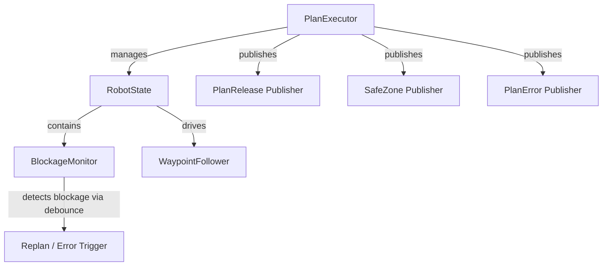
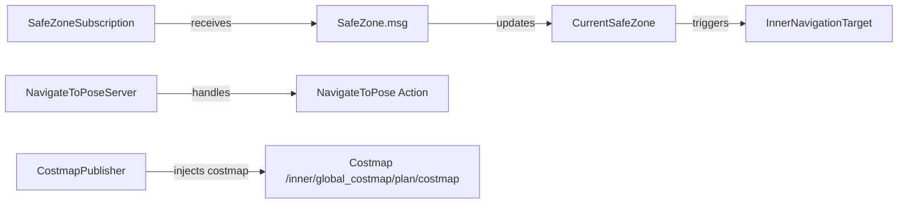

# Plan Interface (`~/plan`)

Relevant source files

The following files were used as context for generating this page:

- [`nav2_integration/rmf_nav2_traffic/src/navigation_server.rs`](https://github.com/open-rmf/next_gen_prototype/blob/9403fb1/nav2_integration/rmf_nav2_traffic/src/navigation_server.rs)
- [`nav2_integration/rmf_nav2_traffic/src/safe_zone.rs`](https://github.com/open-rmf/next_gen_prototype/blob/9403fb1/nav2_integration/rmf_nav2_traffic/src/safe_zone.rs)
- [`path_server/rmf_plan_executor/src/lib.rs`](https://github.com/open-rmf/next_gen_prototype/blob/9403fb1/path_server/rmf_plan_executor/src/lib.rs)
- [`rmf_prototype_msgs/msg/Plan.msg`](https://github.com/open-rmf/next_gen_prototype/blob/9403fb1/rmf_prototype_msgs/msg/Plan.msg)
- [`rmf_prototype_msgs/msg/Progress.msg`](https://github.com/open-rmf/next_gen_prototype/blob/9403fb1/rmf_prototype_msgs/msg/Progress.msg)

The `~/plan` topic family provides the mechanism for robots to receive and execute detailed multi-agent traffic plans. While the `~/destination` interface defines *where* a robot should go, the `~/plan` interface defines *how* it gets there, accounting for trajectories, infrastructure interactions, and traffic dependencies.

## Overview

The Plan Interface is primarily used by the **Plan Server** to command a **Plan Executor**. The Plan Server consumes destination and occupancy data to generate conflict-free routes, while the Plan Executor translates these routes into motor commands and action sequences [`discourse/traffic-management-interfaces.md:63-65`](https://github.com/open-rmf/next_gen_prototype/blob/9403fb1/discourse/traffic-management-interfaces.md#L63-L65).

### Plan Topic Family

| Topic | Message Type | Requirement | Description |
| :--- | :--- | :--- | :--- |
| `~/plan` | `Plan` | Mandatory | The intended route and sequence of waypoints [`discourse/traffic-management-interfaces.md:79`](https://github.com/open-rmf/next_gen_prototype/blob/9403fb1/discourse/traffic-management-interfaces.md#L79). |
| `~/plan/progress` | `Progress` | Mandatory | Feedback on the robot's current position and completed waypoints [`discourse/traffic-management-interfaces.md:80`](https://github.com/open-rmf/next_gen_prototype/blob/9403fb1/discourse/traffic-management-interfaces.md#L80). |
| `~/plan/error` | `PlanError` | Mandatory | Reports execution failures or replan requests [`discourse/traffic-management-interfaces.md:81`](https://github.com/open-rmf/next_gen_prototype/blob/9403fb1/discourse/traffic-management-interfaces.md#L81). |
| `~/plan/release` | `PlanRelease` | Release Component | Indicates how much of the plan is currently cleared for execution [`discourse/traffic-management-interfaces.md:83`](https://github.com/open-rmf/next_gen_prototype/blob/9403fb1/discourse/traffic-management-interfaces.md#L83). |
| `~/plan/safe_zone` | `SafeZone` | SafeZone Component | Provides costmaps and targets for AMR freespace navigation [`discourse/traffic-management-interfaces.md:84`](https://github.com/open-rmf/next_gen_prototype/blob/9403fb1/discourse/traffic-management-interfaces.md#L84). |
| `/plan/discovery` | `ParticipantList` | Recommended | Global topic to discover namespaces participating in planning [`discourse/traffic-management-interfaces.md:82`](https://github.com/open-rmf/next_gen_prototype/blob/9403fb1/discourse/traffic-management-interfaces.md#L82). |

Sources: [`discourse/traffic-management-interfaces.md:63-84`](https://github.com/open-rmf/next_gen_prototype/blob/9403fb1/discourse/traffic-management-interfaces.md#L63-L84)

---

## Plan Server and Plan Executor Architecture

The runtime execution of plans is managed by the `PlanExecutor` node (`rmf_plan_executor`), which tracks active participants, manages robot states, monitors blockages, and interacts with navigation clients [`path_server/rmf_plan_executor/src/lib.rs:42-108`](https://github.com/open-rmf/next_gen_prototype/blob/9403fb1/path_server/rmf_plan_executor/src/lib.rs#L42-L108).

### Diagram: Plan Executor Code Entities and State Management

Sources: [`path_server/rmf_plan_executor/src/lib.rs:42-108`](https://github.com/open-rmf/next_gen_prototype/blob/9403fb1/path_server/rmf_plan_executor/src/lib.rs#L42-L108)

The `PlanExecutor` structure maintains a mapping of active robots (`active_robots`) keyed by their participant names, along with per-robot publishers for `PlanRelease`, `SafeZone`, and `PlanError` [`path_server/rmf_plan_executor/src/lib.rs:93-108`](https://github.com/open-rmf/next_gen_prototype/blob/9403fb1/path_server/rmf_plan_executor/src/lib.rs#L93-L108).

Sources: [`path_server/rmf_plan_executor/src/lib.rs:42-108`](https://github.com/open-rmf/next_gen_prototype/blob/9403fb1/path_server/rmf_plan_executor/src/lib.rs#L42-L108)

---

## Mandatory Topics

### Plan (`Plan.msg`)
The `Plan` message represents a discrete route associated with a specific `destination_session` [`rmf_prototype_msgs/msg/Plan.msg:3-5`](https://github.com/open-rmf/next_gen_prototype/blob/9403fb1/rmf_prototype_msgs/msg/Plan.msg#L3-L5). It contains an array of `Waypoint` objects that define the navigation and action sequence.

* **`plan_id`**: Combines the `destination_session` UUID and a `plan_version` to track revisions caused by traffic changes [`rmf_prototype_msgs/msg/Plan.msg:15`](https://github.com/open-rmf/next_gen_prototype/blob/9403fb1/rmf_prototype_msgs/msg/Plan.msg#L15).
* **`workflow`**: An optional string field defining execution workflows or conditional rules [`rmf_prototype_msgs/msg/Plan.msg:17-25`](https://github.com/open-rmf/next_gen_prototype/blob/9403fb1/rmf_prototype_msgs/msg/Plan.msg#L17-L25).

Sources: [`rmf_prototype_msgs/msg/Plan.msg:1-25`](https://github.com/open-rmf/next_gen_prototype/blob/9403fb1/rmf_prototype_msgs/msg/Plan.msg#L1-L25)

### Progress (`Progress.msg`)
The `Progress` message provides high-fidelity feedback to the traffic system.
* **`progress`**: A continuous float value representing the robot's position along the plan's trajectories [`rmf_prototype_msgs/msg/Progress.msg:3-6`](https://github.com/open-rmf/next_gen_prototype/blob/9403fb1/rmf_prototype_msgs/msg/Progress.msg#L3-L6).
* **`reached_waypoint`**: The index of the last fully completed waypoint [`rmf_prototype_msgs/msg/Progress.msg:8-11`](https://github.com/open-rmf/next_gen_prototype/blob/9403fb1/rmf_prototype_msgs/msg/Progress.msg#L8-L11).
* **`reached_keys`**: An array of `GraphElementKey` nodes/edges that the robot has physically entered [`rmf_prototype_msgs/msg/Progress.msg:18-24`](https://github.com/open-rmf/next_gen_prototype/blob/9403fb1/rmf_prototype_msgs/msg/Progress.msg#L18-L24).

Sources: [`rmf_prototype_msgs/msg/Progress.msg:1-28`](https://github.com/open-rmf/next_gen_prototype/blob/9403fb1/rmf_prototype_msgs/msg/Progress.msg#L1-L28)

### PlanError and Blockage Monitoring
When a robot is blocked, the onboard `BlockageMonitor` checks for timeouts and debounce thresholds before raising a replan request [`path_server/rmf_plan_executor/src/lib.rs:52-91`](https://github.com/open-rmf/next_gen_prototype/blob/9403fb1/path_server/rmf_plan_executor/src/lib.rs#L52-L91).
* **`BLOCKAGE_DEBOUNCE`**: 300ms window before considering a blockage valid [`path_server/rmf_plan_executor/src/lib.rs:38`](https://github.com/open-rmf/next_gen_prototype/blob/9403fb1/path_server/rmf_plan_executor/src/lib.rs#L38).
* **`REPLAN_COOLDOWN`**: 2-second cooldown between successive replan reports [`path_server/rmf_plan_executor/src/lib.rs:39`](https://github.com/open-rmf/next_gen_prototype/blob/9403fb1/path_server/rmf_plan_executor/src/lib.rs#L39).

Sources: [`path_server/rmf_plan_executor/src/lib.rs:38-91`](https://github.com/open-rmf/next_gen_prototype/blob/9403fb1/path_server/rmf_plan_executor/src/lib.rs#L38-L91)

---

## Release Component (`PlanRelease`)

The Release Component is designed for systems that use a "Look-Ahead" or "Horizon" mechanism, such as **VDA5050**.

The `PlanRelease` message identifies the `waypoint_id` up to which the robot is authorized to move. This allows the Plan Server to send a complete long-term plan to the robot but dynamically "release" segments as traffic dependencies (such as a cross-traffic intersection) are cleared.

Sources: [`discourse/traffic-management-interfaces.md:83`](https://github.com/open-rmf/next_gen_prototype/blob/9403fb1/discourse/traffic-management-interfaces.md#L83)

---

## SafeZone Component & AMR Freespace Navigation

The SafeZone component is tailored for **AMRs** performing freespace navigation via Nav2 integration (`rmf_nav2_traffic`). Instead of following a strict line graph, the robot receives a `SafeZone` containing spatial constraints and costmaps.

### Diagram: SafeZone and Nav2 Integration Entities

Sources: [`nav2_integration/rmf_nav2_traffic/src/safe_zone.rs:13-35`](https://github.com/open-rmf/next_gen_prototype/blob/9403fb1/nav2_integration/rmf_nav2_traffic/src/safe_zone.rs#L13-L35), [`nav2_integration/rmf_nav2_traffic/src/navigation_server.rs:28-33`](https://github.com/open-rmf/next_gen_prototype/blob/9403fb1/nav2_integration/rmf_nav2_traffic/src/navigation_server.rs#L28-L33)

### SafeZone Mechanics in Code
* **`SafeZoneSubscription`**: Subscribes to `~/plan/safe_zone` to capture dynamic spatial permissions for each `Nav2Agent` [`nav2_integration/rmf_nav2_traffic/src/safe_zone.rs:13-16`](https://github.com/open-rmf/next_gen_prototype/blob/9403fb1/nav2_integration/rmf_nav2_traffic/src/safe_zone.rs#L13-L16).
* **`CurrentSafeZone`**: Tracks the active safe zone and validates target increments or plan transitions [`nav2_integration/rmf_nav2_traffic/src/safe_zone.rs:33-60`](https://github.com/open-rmf/next_gen_prototype/blob/9403fb1/nav2_integration/rmf_nav2_traffic/src/safe_zone.rs#L33-L60).
* **`NavigateToPoseServer`**: Exposes a standard ROS 2 action server (`/navigate_to_pose`) that translates external navigation requests into inner Open-RMF traffic workflows [`nav2_integration/rmf_nav2_traffic/src/navigation_server.rs:28-33`](https://github.com/open-rmf/next_gen_prototype/blob/9403fb1/nav2_integration/rmf_nav2_traffic/src/navigation_server.rs#L28-L33).

Sources: [`nav2_integration/rmf_nav2_traffic/src/safe_zone.rs:13-96`](https://github.com/open-rmf/next_gen_prototype/blob/9403fb1/nav2_integration/rmf_nav2_traffic/src/safe_zone.rs#L13-L96), [`nav2_integration/rmf_nav2_traffic/src/navigation_server.rs:28-102`](https://github.com/open-rmf/next_gen_prototype/blob/9403fb1/nav2_integration/rmf_nav2_traffic/src/navigation_server.rs#L28-L102)

:::{seealso}
Part of the {doc}`../architecture` guide. Adapted from [2.2 Plan Interface (`~/plan`)](https://deepwiki.com/open-rmf/next_gen_prototype/2.2-plan-interface-(~plan)).
:::
