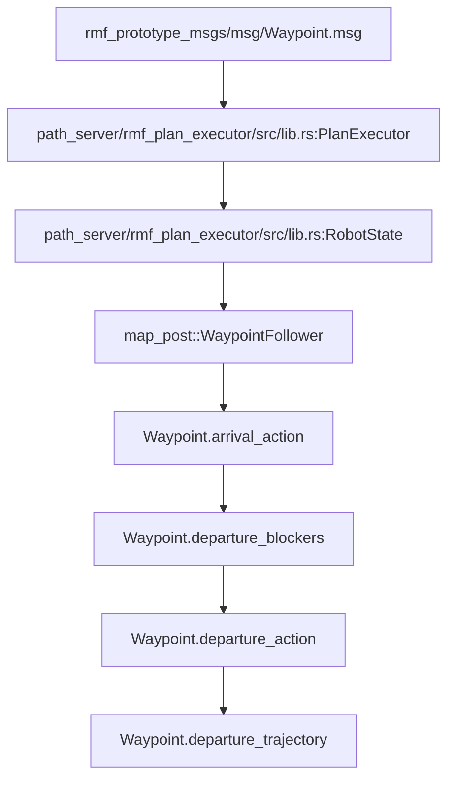
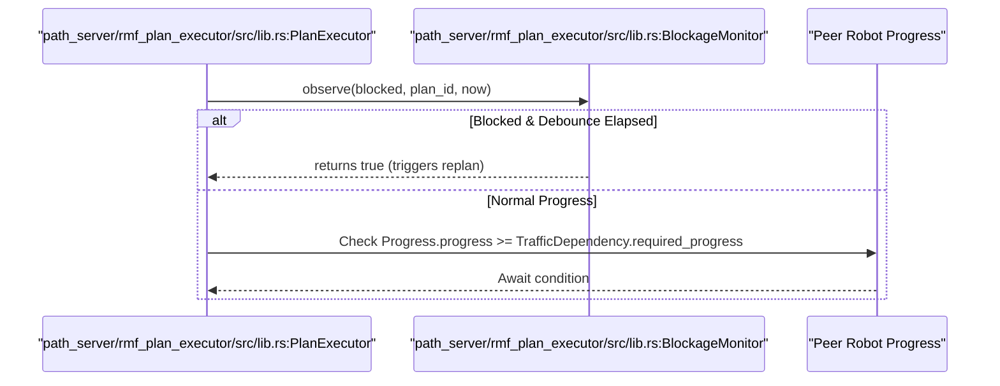

# Waypoint Lifecycle and Traffic Dependencies

Relevant source files

The following files were used as context for generating this page:

- [`nav2_integration/rmf_nav2_traffic/src/navigation_server.rs`](https://github.com/open-rmf/next_gen_prototype/blob/9403fb1/nav2_integration/rmf_nav2_traffic/src/navigation_server.rs)
- [`nav2_integration/rmf_nav2_traffic/src/safe_zone.rs`](https://github.com/open-rmf/next_gen_prototype/blob/9403fb1/nav2_integration/rmf_nav2_traffic/src/safe_zone.rs)
- [`path_server/rmf_plan_executor/src/lib.rs`](https://github.com/open-rmf/next_gen_prototype/blob/9403fb1/path_server/rmf_plan_executor/src/lib.rs)
- [`rmf_prototype_msgs/msg/DestinationConstraints.msg`](https://github.com/open-rmf/next_gen_prototype/blob/9403fb1/rmf_prototype_msgs/msg/DestinationConstraints.msg)
- [`rmf_prototype_msgs/msg/Waypoint.msg`](https://github.com/open-rmf/next_gen_prototype/blob/9403fb1/rmf_prototype_msgs/msg/Waypoint.msg)

This page details the execution lifecycle of a `Plan` waypoint-by-waypoint within the next-generation Open-RMF prototype. It covers arrival constraints and actions, departure blockers (`TrafficDependency`), departure trajectories, and multi-map transitions including lift traversals and safe zone integrations.

---

## 1. Waypoint Structure and State Machine

A `Waypoint` represents a significant semantic location in a robot's plan where it may wait for traffic or execute specific tasks [`rmf_prototype_msgs/msg/Waypoint.msg:3-5`](https://github.com/open-rmf/next_gen_prototype/blob/9403fb1/rmf_prototype_msgs/msg/Waypoint.msg#L3-L5). The execution lifecycle managed by `PlanExecutor` follows a strict progression from arrival to departure.

### Arrival Phase
The robot navigates toward the `position` defined in the waypoint [`rmf_prototype_msgs/msg/Waypoint.msg:17`](https://github.com/open-rmf/next_gen_prototype/blob/9403fb1/rmf_prototype_msgs/msg/Waypoint.msg#L17).
* **Arrival Constraints**: The robot must satisfy `arrival_constraints` (comprising spatial `regions` or graph `nodes`) to be marked as reached [`rmf_prototype_msgs/msg/Waypoint.msg:23`](https://github.com/open-rmf/next_gen_prototype/blob/9403fb1/rmf_prototype_msgs/msg/Waypoint.msg#L23), [`rmf_prototype_msgs/msg/DestinationConstraints.msg:1-18`](https://github.com/open-rmf/next_gen_prototype/blob/9403fb1/rmf_prototype_msgs/msg/DestinationConstraints.msg#L1-L18). These are evaluated using `TargetRegion` parameters or `TargetNode` graph keys [`rmf_prototype_msgs/msg/DestinationConstraints.msg:11-18`](https://github.com/open-rmf/next_gen_prototype/blob/9403fb1/rmf_prototype_msgs/msg/DestinationConstraints.msg#L11-L18).
* **Arrival Action**: Once constraints are met, the `arrival_action` is triggered immediately [`rmf_prototype_msgs/msg/Waypoint.msg:99-101`](https://github.com/open-rmf/next_gen_prototype/blob/9403fb1/rmf_prototype_msgs/msg/Waypoint.msg#L99-L101). Departure is blocked until this action completes [`rmf_prototype_msgs/msg/Waypoint.msg:105-106`](https://github.com/open-rmf/next_gen_prototype/blob/9403fb1/rmf_prototype_msgs/msg/Waypoint.msg#L105-L106).

### Waiting Phase
After the arrival action completes, the robot enters a waiting state if blockers exist.
* **Departure Blockers**: The robot evaluates `departure_blockers`, which is a list of `TrafficDependency` entries requiring peer participants to attain specific `required_progress` levels [`rmf_prototype_msgs/msg/Waypoint.msg:48-52`](https://github.com/open-rmf/next_gen_prototype/blob/9403fb1/rmf_prototype_msgs/msg/Waypoint.msg#L48-L52).

### Departure Phase
Once all blockers clear, the robot transitions to departure.
* **Departure Action**: The `departure_action` is executed to handle hardware interactions or external triggers [`rmf_prototype_msgs/msg/Waypoint.msg:72-82`](https://github.com/open-rmf/next_gen_prototype/blob/9403fb1/rmf_prototype_msgs/msg/Waypoint.msg#L72-L82).
* **Departure Trajectory**: The robot follows the `departure_trajectory` curves toward subsequent waypoints [`rmf_prototype_msgs/msg/Waypoint.msg:55-69`](https://github.com/open-rmf/next_gen_prototype/blob/9403fb1/rmf_prototype_msgs/msg/Waypoint.msg#L55-L69).

**Diagram: Waypoint Execution Mapping to Code Entities**

Sources: [`rmf_prototype_msgs/msg/Waypoint.msg:1-112`](https://github.com/open-rmf/next_gen_prototype/blob/9403fb1/rmf_prototype_msgs/msg/Waypoint.msg#L1-L112), [`path_server/rmf_plan_executor/src/lib.rs:42-50`](https://github.com/open-rmf/next_gen_prototype/blob/9403fb1/path_server/rmf_plan_executor/src/lib.rs#L42-L50), [`rmf_prototype_msgs/msg/DestinationConstraints.msg:1-18`](https://github.com/open-rmf/next_gen_prototype/blob/9403fb1/rmf_prototype_msgs/msg/DestinationConstraints.msg#L1-L18)

---

## 2. Traffic Dependencies and Progress Tracking

Traffic synchronization uses a distributed progress-based framework rather than global locking mechanisms.

* **Progress Value**: Each `Waypoint` specifies a `progress` value, representing estimated elapsed seconds from the plan's start [`rmf_prototype_msgs/msg/Waypoint.msg:33`](https://github.com/open-rmf/next_gen_prototype/blob/9403fb1/rmf_prototype_msgs/msg/Waypoint.msg#L33).
* **TrafficDependency**: Contains a peer participant identifier, plan reference, and a `required_progress` threshold [`rmf_prototype_msgs/msg/Waypoint.msg:48-52`](https://github.com/open-rmf/next_gen_prototype/blob/9403fb1/rmf_prototype_msgs/msg/Waypoint.msg#L48-L52).
* **Blockage Monitoring**: The `BlockageMonitor` struct in `PlanExecutor` tracks execution blockages using configurable timeouts (`BLOCKAGE_DEBOUNCE`, `REPLAN_COOLDOWN`) to trigger replans safely [`path_server/rmf_plan_executor/src/lib.rs:38-91`](https://github.com/open-rmf/next_gen_prototype/blob/9403fb1/path_server/rmf_plan_executor/src/lib.rs#L38-L91).

**Diagram: Blockage Monitoring and Dependency Resolution Flow**

Sources: [`path_server/rmf_plan_executor/src/lib.rs:38-91`](https://github.com/open-rmf/next_gen_prototype/blob/9403fb1/path_server/rmf_plan_executor/src/lib.rs#L38-L91), [`rmf_prototype_msgs/msg/Waypoint.msg:33-52`](https://github.com/open-rmf/next_gen_prototype/blob/9403fb1/rmf_prototype_msgs/msg/Waypoint.msg#L33-L52)

---

## 3. Multi-Map Transitions and Lift Traversal

Waypoints and trajectories support multi-map environments via the `maps` string array [`rmf_prototype_msgs/msg/Waypoint.msg:36-45`](https://github.com/open-rmf/next_gen_prototype/blob/9403fb1/rmf_prototype_msgs/msg/Waypoint.msg#L36-L45).

* **Map Conflict Resolution**: A waypoint listing multiple maps checks for traffic conflicts across all specified maps simultaneously [`rmf_prototype_msgs/msg/Waypoint.msg:38-41`](https://github.com/open-rmf/next_gen_prototype/blob/9403fb1/rmf_prototype_msgs/msg/Waypoint.msg#L38-L41).
* **Lift Traversal Example**: When transitioning from `Level_1` to `Level_2` via `Lift_A`, the `departure_trajectory` sequences multiple curves reflecting changing map contexts [`rmf_prototype_msgs/msg/Waypoint.msg:57-64`](https://github.com/open-rmf/next_gen_prototype/blob/9403fb1/rmf_prototype_msgs/msg/Waypoint.msg#L57-L64):

| Segment | Trajectory Maps | Description |
| :--- | :--- | :--- |
| 1 | `["Level_1", "Lift_A"]` | Crossing threshold into the lift cabin. |
| 2 | `["Lift_A"]` | Inside lift during floor transition. |
| 3 | `["Lift_A", "Level_2"]` | Exiting lift onto the destination floor. |

Sources: [`rmf_prototype_msgs/msg/Waypoint.msg:36-69`](https://github.com/open-rmf/next_gen_prototype/blob/9403fb1/rmf_prototype_msgs/msg/Waypoint.msg#L36-L69)

---

## 4. Execution Logic for Actions and Safe Zones

Actions embedded in waypoints dictate automated behavior upon arrival or departure [`rmf_prototype_msgs/msg/Waypoint.msg:72-112`](https://github.com/open-rmf/next_gen_prototype/blob/9403fb1/rmf_prototype_msgs/msg/Waypoint.msg#L72-L112).

* **Action Fallback Logic**: If an `arrival_action` or `departure_action` relocates the robot, the executor evaluates the robot's resulting position:
  1. Trigger action and wait for completion [`rmf_prototype_msgs/msg/Waypoint.msg:80`](https://github.com/open-rmf/next_gen_prototype/blob/9403fb1/rmf_prototype_msgs/msg/Waypoint.msg#L80).
  2. Evaluate current position against the target waypoint [`rmf_prototype_msgs/msg/Waypoint.msg:87`](https://github.com/open-rmf/next_gen_prototype/blob/9403fb1/rmf_prototype_msgs/msg/Waypoint.msg#L87).
  3. If already arrived at the next waypoint, skip intermediate commands; otherwise, issue direct movement commands [`rmf_prototype_msgs/msg/Waypoint.msg:88-91`](https://github.com/open-rmf/next_gen_prototype/blob/9403fb1/rmf_prototype_msgs/msg/Waypoint.msg#L88-L91).
* **Safe Zone Integration**: Nav2 integration layers synchronize safe zones via `CurrentSafeZone` and `SafeZoneSubscription` components to govern local planner constraints [`nav2_integration/rmf_nav2_traffic/src/safe_zone.rs:14-48`](https://github.com/open-rmf/next_gen_prototype/blob/9403fb1/nav2_integration/rmf_nav2_traffic/src/safe_zone.rs#L14-L48).

Sources: [`rmf_prototype_msgs/msg/Waypoint.msg:72-112`](https://github.com/open-rmf/next_gen_prototype/blob/9403fb1/rmf_prototype_msgs/msg/Waypoint.msg#L72-L112), [`nav2_integration/rmf_nav2_traffic/src/safe_zone.rs:14-96`](https://github.com/open-rmf/next_gen_prototype/blob/9403fb1/nav2_integration/rmf_nav2_traffic/src/safe_zone.rs#L14-L96)

:::{seealso}
Part of the {doc}`../architecture` guide. Adapted from [2.3 Waypoint Lifecycle and Traffic Dependencies](https://deepwiki.com/open-rmf/next_gen_prototype/2.3-waypoint-lifecycle-and-traffic-dependencies).
:::
