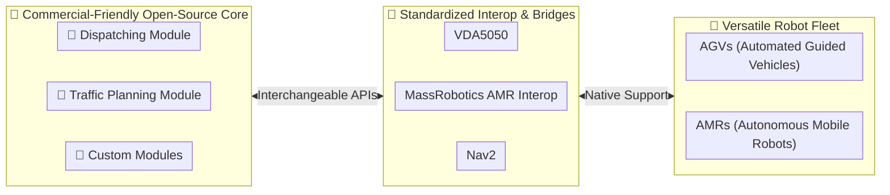

# NGP Documentation

Welcome to the Next-Generation Prototype (NGP) documentation portal.
This snapshot is based on commit `9403fb1` of `open-rmf/next_gen_prototype`
(main branch).

```{warning}
This is an unofficial documentation hub that tracks next_gen_prototype.
```

## What Is `next_gen_prototype`?
A preliminary reference implementation of Open-RMF Next Generation which is built around **4 core design goals**:



| Core Design Goal | Key Highlights | Ecosystem & Scope |
| :--- | :--- | :--- |
| 🧩 **Modularity** | Capabilities like **dispatching** and **traffic planning** are provided by interchangeable, plug-and-play modules. | `Dispatching` · `Traffic Planning` |
| 🔌 **Standardization** | First-class support and native bridges for industry-standard fleet and navigation protocols. | `VDA5050` · `MassRobotics AMR Interop` · `Nav2` |
| 🤖 **Robot Versatility** | Unified, native orchestration for both fixed-path and free-navigating robots. | **AGVs** *(Automated Guided Vehicles)* · **AMRs** *(Autonomous Mobile Robots)* |
| 💼 **Commercial Friendly** | Permissive, open-source reference implementations for all major fleet management capabilities. | `Apache-2.0` Reference Stack |

Use the sections below, or the "Choose version" switcher in the navbar, to
move between different release snapshots.

```{toctree}
:maxdepth: 1
:titlesonly:
:caption: Get Started

get_started/getting_started
```

```{toctree}
:maxdepth: 1
:titlesonly:
:caption: For Users

for_users/tutorials
for_users/how_to_guides
```

```{toctree}
:maxdepth: 1
:titlesonly:
:caption: For Developers

for_developers/architecture
for_developers/library_howtos
for_developers/roadmap
for_developers/development
for_developers/howto_guides
```

```{toctree}
:maxdepth: 1
:titlesonly:
:caption: Reference

reference/release_features
reference/releases
reference/governance
reference/support
```
